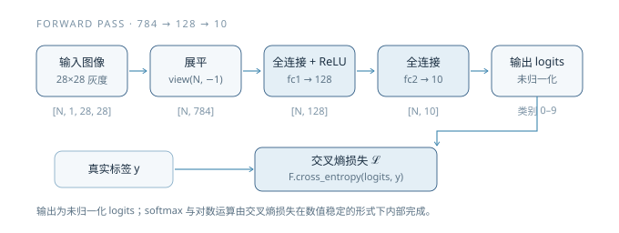
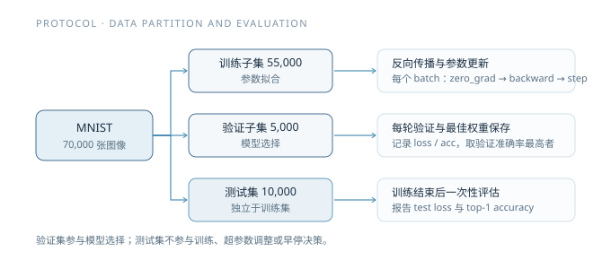

# 基于两层感知机的 MNIST 手写数字分类：一个可复现基线实现

A Reproducible MLP Baseline for MNIST Handwritten Digit Classification

## 1 实验任务与问题定义

本实验考察的是监督学习条件下的单标签图像分类问题。给定灰度图像 $x \in \mathbb{R}^{1 \times 28 \times 28}$ 与类别标签 $y \in \mathcal{Y} = \{0, 1, \dots, 9\}$，需学习参数化映射 $f_\theta: \mathcal{X} \rightarrow \mathbb{R}^{10}$，使经验风险最小，并以 $\arg\max_c f_\theta(x)_c$ 作为预测类别。

数据集采用 MNIST [1]，共 70,000 张 28×28 灰度手写数字图像，其中 60,000 张为训练集、10,000 张为测试集，各类别样本量近似均衡。该数据集规模适中、预处理负担低，适合用于检验训练流程与评估协议的正确性。

本实验的定位是基线（baseline）：在刻意不使用卷积结构、数据增强与学习率调度的条件下，考察仅依赖全连接层的判别器所达到的性能水平，并为后续引入空间归纳偏置的模型提供可比较的参照。因此，本实验不以追求最优精度为目标，而以流程规范性、结果可复现性与指标口径明确性为主要考量。

## 2 方法

### 2.1 网络结构与前向传播

模型 `MLP` 继承 `torch.nn.Module`，由两个全连接层构成：

$$
h = \mathrm{ReLU}(W_1\,\mathrm{vec}(x) + b_1), \qquad z = W_2 h + b_2
$$

其中 $\mathrm{vec}(\cdot)$ 将 $[N,1,28,28]$ 展平为 $[N,784]$，$W_1 \in \mathbb{R}^{128 \times 784}$、$W_2 \in \mathbb{R}^{10 \times 128}$。隐层引入 ReLU 非线性；若无该非线性，两层仿射变换可合并为单一线性映射，模型表达能力将退化。输出 $z$ 为未归一化的 logits，不在网络末端施加 softmax。隐层维度默认为 128（与参考实现一致），可训练参数总量为 $784 \times 128 + 128 + 128 \times 10 + 10 = 101{,}770$。展平操作被置于 `forward` 内部，可避免训练与推理阶段预处理不一致。



图 1：前向传播与损失计算。方框内为主计算步骤，下方标注对应张量形状；两层可学习参数以较深底色区分。真实标签与 logits 共同输入交叉熵损失。

| 阶段 | 张量形状 | 说明 |
| :--- | :--- | :--- |
| 输入 | $[N,1,28,28]$ | 经 `ToTensor` 与 `Normalize` 的灰度图像 |
| 展平 | $[N,784]$ | `x.view(x.size(0), -1)` |
| 隐层 | $[N,128]$ | `fc1` 与 `ReLU` |
| 输出 | $[N,10]$ | `fc2` 输出 logits |
| 预测 | $[N]$ | `argmax(dim=1)` 得到类别索引 |

### 2.2 目标函数

采用多类交叉熵损失，对单个批次定义为

$$
\mathcal{L} = -\frac{1}{N}\sum_{i=1}^{N} \log \frac{\exp(z_{i,y_i})}{\sum_{c=1}^{10} \exp(z_{i,c})}
$$

实现中直接调用 `F.cross_entropy(logits, y)`。该函数在内部以 log-sum-exp 形式完成 `log_softmax` 与负对数似然的组合，因而数值稳定性优于先显式计算 softmax 再取对数的写法；相应地，模型末端不应再添加 softmax，否则将重复归一化并改变梯度尺度。

训练阶段以批次均值损失执行反向传播；统计阶段按样本数加权累加（见 3.2 节），二者口径分离。

### 2.3 优化算法与训练流程

优化器为随机梯度下降（`torch.optim.SGD`），学习率 0.01，动量默认 0.0，与参考实现保持一致以便对照。每个批次依次执行四步：

```text
optimizer.zero_grad(set_to_none=True)
logits = model(x)
loss   = F.cross_entropy(logits, y)
loss.backward()
optimizer.step()
```

每个训练轮次结束后，在验证集上以 `torch.no_grad()` 与 `model.eval()` 执行一次评估；若验证准确率超过历史最优值，则以 `state_dict` 的浅拷贝保存最佳权重。可选早停（`--patience`）以验证准确率的连续未改善轮数为判据。训练终止后，加载最佳权重，在测试集上进行唯一一次评估。

## 3 数据与评估协议



图 2：数据集划分与评估协议。验证集从原始训练集中按固定种子划分；测试集在整个训练与模型选择过程中保持不可见。

### 3.1 预处理与划分

预处理链依次为 `ToTensor` 与 `Normalize((0.1307,), (0.3081,))`。前者将 PIL 图像转换为 $[0,1]$ 区间的张量并增加通道维；后者采用 MNIST 训练集常用的全局均值与标准差进行标准化，使输入分布近似零均值、单位方差，有利于梯度尺度稳定。参考实现仅包含 `ToTensor`。

原始 60,000 张训练图像按固定随机种子划分为 55,000 张训练子集与 5,000 张验证子集；10,000 张测试图像不参与划分。划分由 `random_split` 配合独立的 `torch.Generator` 完成，训练集批次的打乱顺序由另一个独立生成器控制，验证集与测试集均不 shuffling。

| 子集 | 样本数 | 用途 |
| :--- | ---: | :--- |
| 训练子集 | 55,000 | 梯度计算与参数更新 |
| 验证子集 | 5,000 | 逐轮监控、模型选择、早停判据 |
| 测试集 | 10,000 | 训练结束后的单次最终评估 |

该划分的目的是隔离模型选择与性能报告两个环节。若以测试集准确率选择最佳轮次或调整超参数，测试集信息将隐式进入训练决策，导致报告指标产生乐观偏差。参考实现中评估段位于 `for epoch` 循环之外，30 轮训练结束后才评估一次，且打印语句中的 `epoch` 为循环变量的残留值；本实现将逐轮评估移入循环内，并明确区分验证与测试两阶段。

### 3.2 指标定义与统计口径

- 平均交叉熵损失：$\bar{\mathcal{L}} = \dfrac{\sum_{b} n_b \ell_b}{\sum_{b} n_b}$，其中 $n_b$ 为第 $b$ 个批次的样本数、$\ell_b$ 为该批次均值损失。
- Top-1 准确率：$\mathrm{Acc} = \dfrac{1}{N}\sum_{i=1}^{N}\mathbb{1}\left[\arg\max_c z_{i,c} = y_i\right]$，由 `logits.argmax(dim=1) == y` 逐元素统计。

参考实现以 `test_loss / (batch_idx + 1)` 对批次均值作等权平均；当最后一个批次样本数不足 `batch_size` 时，该口径会高估其权重。本实现改为按样本数加权，使统计量与全体样本上的均值损失一致。

## 4 实验配置

表 1 默认超参数与实验环境

| 参数 | 默认值 | 说明 |
| :--- | :--- | :--- |
| `seed` | 42 | 全局随机种子 |
| `epochs` | 30 | 最大训练轮次 |
| `batch_size` | 2048 | 批次大小（与参考实现一致） |
| `lr` | 0.01 | SGD 学习率 |
| `momentum` | 0.0 | 动量系数，默认关闭以保持可比性 |
| `hidden` | 128 | 隐层单元数 |
| `val_size` | 5,000 | 从训练集划出的验证样本数 |
| `patience` | 0 | 早停耐心值，0 表示不启用 |
| 输入标准化 | (0.1307, 0.3081) | 均值与标准差 |
| 损失 / 优化器 | Cross-entropy / SGD | 见 2.2 与 2.3 节 |
| 设备 | `auto` | 优先 CUDA，其次 MPS，最后 CPU |
| `num_workers` | 0 | 单进程加载，保证批次顺序确定性 |
| Python / PyTorch | 3.9 及以上 / 2.0 及以上 | 实际版本写入 `config.json` |

## 5 复现流程

### 5.1 环境准备

```bash
python -m venv .venv
# Windows 使用 .venv\Scripts\activate；Linux 与 macOS 使用 source .venv/bin/activate
pip install -r requirements.txt
```

`torch` 与 `torchvision` 需版本匹配；使用 GPU 时建议按 [PyTorch 官方安装向导](https://pytorch.org/get-started/locally/) 选择对应 CUDA 版本后再安装其余依赖。

### 5.2 标准运行

```bash
python mlp_mnist.py
```

首次执行将自动下载 MNIST 至 `data/`（约 12 MB）；若数据已就位，可追加 `--no-download`。运行结束后在控制台输出汇总信息，并在 `results/` 写入全部产物。

### 5.3 变体运行示例

```bash
# 显式指定 CPU、启用早停
python mlp_mnist.py --device cpu --patience 5

# 改变模型容量与优化设置，输出到独立目录以便对照
python mlp_mnist.py --hidden 256 --lr 0.05 --batch-size 256 --seed 7 --output-dir results/h256
```

表 2 主要命令行参数

| 参数 | 作用 |
| :--- | :--- |
| `--seed` / `--epochs` / `--lr` / `--momentum` | 随机种子、轮次、学习率、动量 |
| `--batch-size` / `--hidden` / `--val-size` | 批次大小、隐层宽度、验证集规模 |
| `--patience` | 早停耐心值，0 为关闭 |
| `--device` | `auto` / `cuda` / `cpu` / `mps` |
| `--data-dir` / `--output-dir` | 数据目录与结果目录 |
| `--num-workers` | 数据加载子进程数；大于 0 时需自行保证 worker 级确定性 |
| `--no-download` / `--no-save` / `--no-plot` / `--no-deterministic` | 关闭下载、持久化、绘图、确定性算子约束 |

控制台每个轮次输出一行，依次包含轮次编号、训练集损失、训练集准确率、验证集损失与验证集准确率。训练结束后另输出一行汇总，包含最佳轮次、最佳验证准确率、测试损失、测试准确率、可训练参数量与实际使用的设备。本文件不预置任何实验结果数值，全部指标以本地实际运行为准。

## 6 输出产物

表 3 `results/` 目录内容

| 文件 | 内容 |
| :--- | :--- |
| `config.json` | 全部超参数、解析后的设备、Python / PyTorch / 操作系统版本 |
| `history.csv` | 逐轮 `train_loss`、`train_acc`、`val_loss`、`val_acc` |
| `metrics.json` | 数据规模、参数量、最佳轮次与验证准确率、测试损失与准确率、耗时、环境信息 |
| `training_curves.png` | 损失与准确率双联曲线，采用与 `assets/` 一致的冷色调配色 |
| `best_model.pt` | 验证集最优轮次的 `state_dict`、轮次、配置与验证准确率 |

`results/` 与 `data/` 默认由 `.gitignore` 排除，以避免将数据集和权重纳入版本控制。若需在仓库页面展示实测曲线，可对单个文件执行 `git add -f results/training_curves.png`，并在本节替换为实际图表与数值。

## 7 与参考实现的差异

表 4 改进项及其目的

| 维度 | 参考实现 | 本实现 | 目的 |
| :--- | :--- | :--- | :--- |
| 随机性控制 | 未设置种子 | 固定 Python / NumPy / CPU / CUDA 随机源，启用确定性算子 | 跨次运行结果一致 |
| 输入预处理 | 仅 `ToTensor` | 增加 `Normalize` | 稳定输入分布与梯度尺度 |
| 数据划分 | 训练集 + 测试集 | 训练 / 验证 / 测试三分 | 隔离模型选择与性能报告 |
| 评估时机 | 训练循环之外，仅一次 | 每轮验证，训练结束后再测试一次 | 观察收敛、支持模型选择与早停 |
| 损失统计 | 批次均值等权平均 | 按样本数加权 | 修正末批不等长带来的偏差 |
| 权重选择 | 使用最后一轮权重 | 保存并加载验证集最优权重 | 避免末期过拟合影响报告 |
| 超参数记录 | 硬编码于脚本 | `argparse` + `config.json` | 参数可追溯、便于消融 |
| 结果持久化 | 仅终端打印 | CSV / JSON / PNG / 权重 | 支持复算、作图与对照 |
| 展平位置 | 训练循环内 `view` | 置于 `forward` 内部 | 保证训练与推理预处理一致 |
| 网络与优化设置 | 784-128-10，SGD lr=0.01 | 保持不变 | 维持与参考结果的可比性 |

## 8 可复现性控制

除固定全局种子外，本实现在以下环节施加约束：

1. `cudnn.deterministic = True`、`cudnn.benchmark = False`，并调用 `use_deterministic_algorithms(warn_only=True)`；CUDA 情形下预设 `CUBLAS_WORKSPACE_CONFIG=:4096:8`。
2. `random_split` 与训练集 `DataLoader` 的 shuffling 分别使用独立 seed 的 `torch.Generator`，互不干扰。
3. `num_workers` 默认为 0。启用多进程加载时，需额外配置 `worker_init_fn` 与每 worker 种子，否则无法保证批次顺序一致。
4. 全部超参数与运行环境的实际版本写入 `config.json`，`metrics.json` 记录实际设备、参数量与耗时，便于事后核对。

需指出，不同 GPU 架构、CUDA 版本或 PyTorch 版本仍可能在浮点运算末位产生差异；确定性约束的目标是消除随机性来源，而非保证跨平台逐位一致。若需统计意义上的结论，应固定硬件与依赖版本，并在多个种子下重复实验后报告均值与标准差。

## 9 局限性与适用范围

展平操作丢弃二维空间结构，模型不具备平移等变性，其精度上限低于卷积网络；本实现未使用数据增强、权重衰减、Dropout 或学习率调度。

验证集为单次固定划分，未采用交叉验证；结果基于单一随机种子，不提供置信区间。

测试集仅用于最终报告，不承担超参数搜索职能；如需调参，应在验证集上完成并另设独立测试评估。

本实现面向课程实验与方法学演示，不构成针对 MNIST 的性能最优方案。

## 10 参考文献

[1] LeCun, Y., Bottou, L., Bengio, Y., & Haffner, P. (1998). Gradient-based learning applied to document recognition. *Proceedings of the IEEE*, 86(11), 2278-2324.

[2] Paszke, A., Gross, S., Massa, F., et al. (2019). PyTorch: An Imperative Style, High-Performance Deep Learning Library. *Advances in Neural Information Processing Systems*, 32.

[3] 课程实验四参考代码 `mlp_mnist.ipynb`（MLP on MNIST）。本实现涉及的 PyTorch 接口细节参见 [2]。

## 附：仓库结构

- README.md：任务定义、方法、协议与复现说明
- mlp_mnist.py：可复现训练与评估脚本
- requirements.txt：依赖声明
- .gitignore：版本控制排除规则
- assets/fig1_forward_pass.svg：图 1，网络结构与前向传播
- assets/fig2_protocol.svg：图 2，数据集划分与评估协议

运行后生成的 `data/` 与 `results/` 不纳入版本控制。
